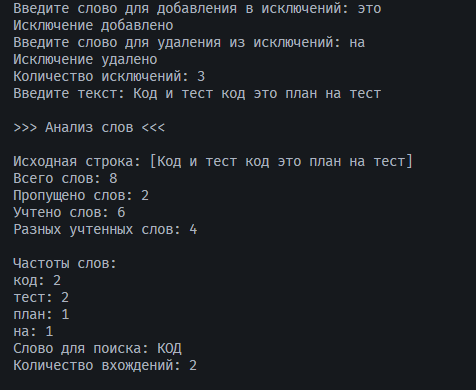

# Практическая работа №22

Автор: Алексеевская Елена

Группа: ИСП-251

## Тема

Dictionary и HashSet в C#.

## Что реализовано

- хранение исключений в HashSet;
- добавление и удаление исключений;
- подготовка и разделение текста на слова;
- подсчёт частот в Dictionary;
- вывод общей статистики;
- безопасный поиск слова через TryGetValue.

## Короткие ответы

1. Что должно быть уникальным в Dictionary и в HashSet?

Ответ: В Dictionary уникальны ключи, значения могут повторяться, а в в HashSet уникален каждый элемент.

2. Чем отличается повторное добавление в HashSet от Dictionary.Add() с существующим ключом?

Ответ: HashSet.Add при существующем элементе возвращает false и не меняет множество, а Dictionary.Add() с существующим ключом бросает исключение.

3. Почему для поиска по неизвестному ключу удобно использовать TryGetValue()?

Ответ: TryGetValue() не бросает исключение при отсутствии ключа, а возвращает false, и сразу записывает найденное значение в out-переменную, наличие ключа определяется по bool, а не по значению.

## Результат
